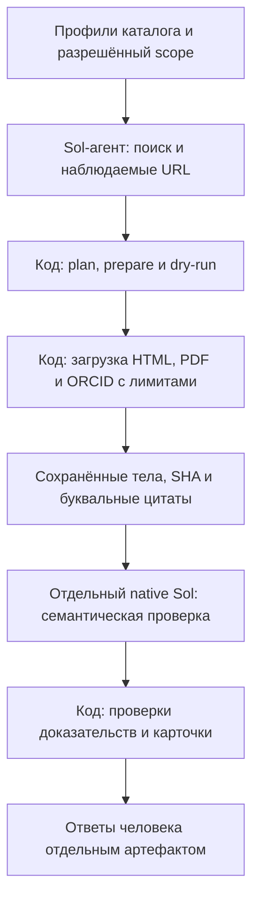

# Enrichment: явный поиск → источники → Sol → человек

**Основной вход в модуль, состояние на 14.10.2026 после merge
[PR #210](https://github.com/borisboriov/search-for-research/pull/210).** Здесь —
поддерживаемый процесс, установка, входы и правила запуска. Датированные
эксперименты, их метрики и частные архивы — в [карте исследований](research/INDEX.md).
Исторические методики и `scripts/enrichment_*` не являются инструкцией нового запуска.

## Зачем нужен модуль и где его границы

`enrichment` — отдельный технический и исследовательский модуль внутри
репозитория SFR, со своим CLI, кодом, тестами и материалами экспериментов.
Это не отдельный бизнес и не готовая функция production-сайта. Он использует
ресурсы этого репозитория; самостоятельная установка вне него и перенос на
другой компьютер в live-режиме пока не доказаны.

Продуктовая проблема: после подбора исследователя студенту нужно найти способ
связаться с ним. Рабочая продуктовая гипотеза — контакты с понятным источником
и подтверждённой принадлежностью уменьшают ручной поиск и помогают перейти
от подбора к обращению. Рост обращений, ответов учёных и успешных пар
«студент — руководитель» этими техническими опытами ещё не проверен.
Общий контекст и требования принадлежат [брифу](../docs/product/brief.md)
и [спецификации, C5–C6](../docs/product/mvp_spec.md).

Задача модуля — получить проверяемые кандидаты контактов из публичных
профессиональных источников для заданных профилей каталога. Личность нельзя
связать одним совпадением имени; нужны идентификаторы и предметные якоря.
Email на странице не доказывает его доставляемость, нынешнюю актуальность
или готовность учёного брать студентов. Рассылки и изменение production
данных в рабочий цикл модуля не входят.

## Как устроен поддерживаемый путь



Поиск пока выполняет внешний агент; CLI не содержит собственного поисковика.
Код отвечает за очередь, ограничения, сохранение источников, привязку цитат,
учёт попыток и подготовку карточек. Отдельный проверяющий оценивает личность,
принадлежность контакта и смысл доказательств по полной рубрике. Человек
проверяет текст, принадлежность, датированность источника и свидетельства
нынешней актуальности раздельно; «недостаточно оснований» допустимо.
Выход — локальные артефакты и карточки, не автоматическая публикация контактов.
Исторические GLM/Pi варианты сохранены для исследования, но не являются
поддерживаемым маршрутом запуска. Причины решений — в
[DECISIONS](../docs/DECISIONS.md), доказательства — в [карте](research/INDEX.md).

## Текущее состояние и ограничения

Перенос модуля (#194), бесплатное сравнение компонентов (#198/#200), рабочая
интеграция (#202/#204), поиск по пропускам (#205/#206), незавершённый первый
прогон десятки (#207/#208) и его ограниченное продолжение (#209/#210) влиты.
Подробная последовательность и исходные измерения находятся в
[INDEX](research/INDEX.md); старые отрицательные результаты сохранены.

Последняя десятка имеет **10 явных исходов, из них 6 проверены моделью**:
два входа остались больше 1 MB, ещё два ответа не прошли проверку даты.
Sol принял 3 личных контакта у 3 людей. Это завершение очереди, не 10/10
проверенных профилей. [Отчёт #209](research/reports/compact209_20261014.md)
сохраняет измеренный результат и `human 0` на момент прогона.

**Последующая человеческая проверка хранится отдельно.** Борис проверил эти
3 контакта: текст и принадлежность согласованы у всех трёх; у двух согласованы
также дата источника и приведённые основания актуальности, у одного дата
неопределённа, с актуальностью человек не согласился. Это оценка предъявленных
доказательств, не проверка доставляемости или готовности принимать студентов.
Происхождение отдельной записи раскрыто в [карте](research/INDEX.md#текущее-состояние-и-последовательность-этапов).

Рабочий процесс применим к разрешённым партиям **1–10 профилей**, с отдельным
поиском и просмотром карточек человеком. Бесплатное сравнение #198 завершено;
платная часть с поиском Яндекса не разрешена. Новая партия, расходы и внедрение
требуют отдельного поручения. Обогащение не выложено, production-каталог не менялся.
Полное покрытие, регулярное обновление, переносимость live-режима, массовая
экономика и доля ручного труда не установлены. Поиск студентов и условия набора
не входят в поддерживаемый контактный процесс.

## Возможное исследование Бориса для НИР-3

Модуль предоставляет инженерный объект и доказательства для возможного
исследования достоверности профилей. Личный вопрос, гипотеза и методика ведутся
в [#154](https://github.com/borisboriov/search-for-research/issues/154), основания —
в [обзоре](../docs/product/research/profile_evidence_review_2026-10.md), требования —
в [документе НИР-3](../docs/product/course_grading_NIR3.md). Направление раздельной
проверки личности, смысла поля и времени ещё не является согласованным протоколом.
Инженерный вопрос затрат рассматривается в [сравнении #198](research/reports/free_components198_20261013.md)
и не заменяет эту гипотезу. Исторические результаты и разметка — материал разработки,
не независимый тест новой гипотезы. Второй план НИР и копии корпусов здесь не ведём.

## Структура модуля

| Часть | Назначение |
|---|---|
| `src/sfr_enrichment/` | Поддерживаемый runtime: loader, literal binding, native verifier, guards, human cards |
| `configs/verifier-v3.md` | Прежняя рубрика, байты не изменены |
| `tests/` | Перенесённые регрессии и проверки границ модуля с заблокированными реальными транспортами |
| `research/methods/`, `research/reports/` | Версионированные методики и результаты прежних этапов |
| `research/legacy/` | Исторические GLM/night/Pi эксперименты; runtime их не импортирует |

## Установка и проверка без сети

Нужен checkout этого репозитория на конкретном Git SHA, Python 3.12+ и `uv`.
Из корня: `uv sync --locked --all-packages --group enrichment`, затем `make unhide`
(для editable imports на macOS). Версии библиотек заданы `uv.lock`, включая
PDF-парсер `pypdf`. Изолированного wheel без ресурсов репозитория недостаточно.
Offline повтор установки возможен только при уже заполненном кэше зависимостей.
Команда `uv run sfr-enrichment --help` показывает единый CLI; равнозначен
`.venv/bin/python -m sfr_enrichment`.

После установки один воспроизводимый offline запуск регрессий из корня:

```sh
.venv/bin/python enrichment/tests/run_offline.py
```

Он блокирует реальную сеть и запуски клиентов моделей; локальные Python-процессы
для help и PDF разрешены. Для проверки собственного сохранённого sealed архива:

```sh
.venv/bin/python -m sfr_enrichment archive-check \
  --root "$SFR_ENRICHMENT_ARCHIVE" --index "$SFR_ENRICHMENT_INDEX" \
  --index-sha "$SFR_ENRICHMENT_INDEX_SHA"
```

Все три значения берутся из частного каталога архивов. Для final assisted live3
проверено 219 mapped файлов; полный SHA transfer index начинается `183162a57035`.
Точный индекс, SHA и путь сохранены в архиве, без переименования. Команда читает
данные и не вызывает источники или модели. `saved` дополнительно проверяет
старый baseline и создаёт новый локальный human packet, поэтому требует нового
выходного root. Точные исторические входы для него — в
[датированной методике](research/methods/enrichment_glm_runner.md#пересоздать-baseline-карточки-без-вызовов-контактный-протокол-v4).

## Входы нового разрешённого запуска

Подготовить три локальных JSON. Пути, источники, разрешение и лимиты задаются
для конкретного запуска; пример команд ниже сам по себе не разрешает сбор.

| Вход | Контракт |
|---|---|
| Локальный вход profiles.json | Список 1–10 каталожных профилей с уникальными `id`; передать имеющиеся имя, организацию, ORCID и предметные якоря для проверки личности |
| Локальный вход plan.json | `schema: sol-assisted-contacts-v1`, `requested_search_model: gpt-6.1-sol`, `requested_search_effort: high`, `profiles: [{author_id, sources: [...]}]`; те же ID, 1–8 уникальных наблюдённых URL на профиль |
| Элемент `sources` | `url`, `kind` из `direct_http` / `direct_pdf` / `structured_orcid`, `discovery: {method, observed_url, note, query}`. `method`: `agent_search`, `observed_href` либо `known_orcid`; `observed_url` совпадает с `url`, `note` непустой, `query` обязателен для `agent_search` |
| Локальный вход scope.json | `authorization_reference`, явный bool `live_authorized`, `deadline_acquisition` и `deadline_verification` с часовым поясом; `HTTP_total_cap` 1–200, `HTTP_per_profile_cap` 1–30, `remaining_stop` из 0/5/15 (0 — только по прямому разрешению) |
| Дополнительные ограничения scope | `model_job_cap` 1…число профилей (по умолчанию число профилей); опциональный `disk_byte_cap` 1…512 MiB. Для ORCID — `ORCID_policy` с `access: allowed`, `source: https://pub.orcid.org/v3.0` и сохранённым основанием доступа |

Диапазоны — возможности CLI, не автоматически разрешённый бюджет. Поисковый
агент сохраняет фактические запросы, наблюдённые URL и доступные tool receipts.
`discovery` является записью агента, не независимым подтверждением физического
запроса. Сниппеты и предполагаемые ответы не заменяют загруженный источник.
Неизвестные usage, фактическая модель/effort и стоимость остаются неизвестными.

Для проверенного буквального MathNet-декодера предусмотрен `render_mathnet: true`
только у `direct_http`; известный шаблон также обнаруживается автоматически.
Код читает наблюдённый script URL и распознаёт поддерживаемую функцию, не исполняет
произвольный JS. Эти запросы входят в HTTP-бюджет. Универсальные браузер/OCR и
автономный поиск в рабочий CLI не входят.

## Поддерживаемые команды и исходы

Для другого компьютера нужны тот же Git SHA/lock, локальные входы, новый частный
абсолютный data-root, действующий доступ native `codex` CLI по подписке и отдельно
доступный поисковый инструмент у Sol-агента. CLI поиска не предоставляет;
запись discovery не заменяет tool receipt. Исторические Pi SDK зависимости не
нужны рабочему пути. Пользователь отдельно задаёт выборку, разрешение, HTTP/model
лимиты, сроки и основание ORCID access. Поиск передаёт локальные profiles.json и
plan.json; scope.json фиксирует это разрешение.

После такого разрешения из корня checkout:

```sh
uv run sfr-enrichment prepare --root "$SFR_ENRICHMENT_DATA_ROOT" \
  --profiles /absolute/profiles.json --plan /absolute/plan.json --scope /absolute/scope.json
uv run sfr-enrichment dry-run --root "$SFR_ENRICHMENT_DATA_ROOT"
uv run sfr-enrichment status --root "$SFR_ENRICHMENT_DATA_ROOT"
# Только для отдельно разрешённого live scope и фактического официального остатка:
uv run sfr-enrichment run --live --root "$SFR_ENRICHMENT_DATA_ROOT" \
  --remaining-percent ACTUAL_OFFICIAL_PERCENT --author-id FIRST_FROZEN_PROFILE_ID
# Затем весь тот же frozen sample: готовый smoke output переиспользуется.
uv run sfr-enrichment run --live --root "$SFR_ENRICHMENT_DATA_ROOT" \
  --remaining-percent ACTUAL_OFFICIAL_PERCENT
```

`prepare` фиксирует sample/plan/scope/policy и SHA фактического рабочего кода,
lock, packaging и рубрики; источники и модели не вызывает. `dry-run` проверяет
freeze, `status` показывает состояние. `run` выполняет автоматические стадии
после внешнего поиска; один writer lock защищает root. Завершённые результаты
перепроверяются и используются без нового модельного вызова.

| Ситуация | Поведение текущего CLI |
|---|---|
| Ожидаемая недоступность источника, отказ robots/access или лимит одного профиля | Сохраняется причина в `source-failures`; разрешённые независимые источники/профили продолжаются. Domain STOP сохраняется для соответствующего домена |
| Нет пригодных источников / нет доказательств | Профиль получает `no_usable_source` / `empty_evidence`, модель не вызывается; это не отсутствие контакта у человека |
| Доставляемый input + instruction больше 1 000 000 bytes после lossless уплотнения | `input_too_large`, без модели и обрезки доказательств; следующие профили продолжаются |
| Неподдержанная metadata-дата личности либо год даты отсутствует в cited refs | После проверки целостности результат сохраняется как `invalid_identity_metadata_date` / `date_year_absent_unverified`; проверенная карточка не выдаётся, остальные профили продолжаются |
| Исчерпаны общие HTTP/model/disk/quota лимиты или deadline; root/parent STOP; неизвестный исход начатой попытки | Новые вызовы прекращаются; это не локальный отказ, который можно пропустить |
| Изменены freeze/SHA, неверна схема/ссылка доказательства или обнаружена иная ошибка целостности/даты | Ошибка останавливает запуск. Исключения из предыдущих строк не ослабляют общую проверку |

Карточки строятся только для результатов, прошедших проверки источников, схемы
и даты. Непроверенные исходы видны в progress; если проверенных результатов нет,
создаётся локальный unverified-progress.json, а не пустой успешный пакет. Завершение
очереди не означает успешной проверки всех профилей.

**Продолжение:** тот же незавершённый root допустим только в рамках прежнего
разрешения, с теми же freeze и лимитами, без STOP и неизвестных попыток. Готовые
и отклонённые профили/источники автоматически не повторяются. Нельзя удалять
STOP, менять caps или переписывать результаты для возобновления. После изменения
кода или отдельного разрешённого продолжения нужен новый согласованный root;
перенос результатов требует проверки SHA и раздельного учёта прежних затрат.
Универсальной команды миграции исторического запуска CLI не предоставляет.

Человек проверяет скачанную карточку и сохраняет фактические ответы отдельно:

```sh
uv run sfr-enrichment human import --root /absolute/new-human-answers-root \
  --manifest /absolute/packet/manifest.json --answers /absolute/human-answers.json \
  --record-id ACTUAL_RECORD_ID
```

Для контактного протокола v4 это четыре независимые оси: `text`, `identity`,
`source_date`, `current`. Неопределённость допустима; ответ о приведённых
доказательствах не подтверждает доставляемость или набор студентов. Частные
ответы не включаются в Git и не меняют frozen метрики исходного прогона.

## Совместимость и хранение

Прежние Python entrypoints в `scripts/enrichment_*.py` и JS-адаптеры сохранены
для исторической совместимости и replay. Они не рекомендуются для новой работы;
единственный поддерживаемый вход — `sfr-enrichment`. `research/legacy/` и
датированные методики объясняют старые протоколы. Для проверки исторического
freeze нужны его точные Git SHA и lock; новый код не подставляется вместо них.

Новый рабочий путь сохраняет один `events.jsonl` native verifier, полный raw/result,
receipt, request, usage, ошибки и timeout. Pi-клиент с отдельным полным snapshot
на каждый token delta не импортируется. Это устранение источника будущего
раздувания без сжатия. В рабочем assisted verifier #202 stdout/events и stderr
ограничены **16 MiB каждый**: переполнение завершает job без повтора и сохраняет
частичный лог/отказ. Источники и производные сохраняются полностью в действующих
лимитах (8 MiB PDF, 2 MiB другие ответы). Опциональный `scope.disk_byte_cap`
проверяется перед HTTP и native job с консервативным резервом; в #202 задано
128 MiB. Это отдельное ограничение от лимита каждого потока.

Частные данные, raw, human answers, STOP и seals не входят в git. Старые архивы
сейчас объединены ссылками в каталоге: ни перемещения, ни удаления, ни сжатия,
ни освобождённого места. Для будущих запусков предлагается один внешний
`SFR_ENRICHMENT_DATA_ROOT` с отдельным root на разрешённый run; прежние каталоги
остаются адресуемыми оригиналами.

## Offline-подготовка НИР: общая и раздельная проверка email

[`sfr_enrichment.nir`](src/sfr_enrichment/nir.py) дополняет существующее хранение
снимков и отдельных человеческих решений для [методики НИР B/C](research/methods/nir_email_bc_v1.md).
Модуль только читает локальные файлы и создаёт новые артефакты вне Git. В нём
**нет получения источников, модельного транспорта или реального запуска B/C**.
Его подготовка и синтетические тесты не означают выполненный пилот. Старые
карточки `human` показывают модельные решения и для независимой разметки нового
пилота не подходят; новый экспорт использует отдельный нейтральный контракт.

Команды из корня репозитория (пути ниже обозначают подготовленные приватные входы):

```bash
uv run --frozen python -m sfr_enrichment.nir freeze --root /private/tmp/nir-private/run-v1 --selection /private/tmp/nir-private/selection.json --exclusions /private/tmp/nir-private/exclusions.json --protocol /private/tmp/nir-private/protocol.json
uv run --frozen python -m sfr_enrichment.nir export --root /private/tmp/nir-private/run-v1 --annotator adelina
uv run --frozen python -m sfr_enrichment.nir export --root /private/tmp/nir-private/run-v1 --annotator sasha
uv run --frozen python -m sfr_enrichment.nir import-human --root /private/tmp/nir-private/run-v1 --answers /private/tmp/nir-private/adelina-answers.json --record-id first
uv run --frozen python -m sfr_enrichment.nir import-human --root /private/tmp/nir-private/run-v1 --answers /private/tmp/nir-private/sasha-answers.json --record-id first
uv run --frozen python -m sfr_enrichment.nir import-model --root /private/tmp/nir-private/run-v1 --answers /private/tmp/nir-private/model-B.json --record-id first
uv run --frozen python -m sfr_enrichment.nir import-model --root /private/tmp/nir-private/run-v1 --answers /private/tmp/nir-private/model-C.json --record-id first
uv run --frozen python -m sfr_enrichment.nir adjudicate --root /private/tmp/nir-private/run-v1 --answers /private/tmp/nir-private/adjudication.json --record-id first
uv run --frozen python -m sfr_enrichment.nir analyze --root /private/tmp/nir-private/run-v1 --out /private/tmp/nir-private/analysis-v1.json --seed 154 --resamples 2000
```

Это последовательность подготовки и импорта **уже существующих** ответов. Переход
к реальному сбору и B/C требует отдельного разрешения, завершённого протокола и
ресурсной проверки перед использованием существующего native-транспорта. Текущий CLI обогащения сохраняет
свой лимит 1–10 профилей: `nir freeze` не получает ни одного нового профиля и не
повышает этот лимит. Офлайн-выборка может включать несколько заранее разрешённых
партий; связь человека между партиями сохраняется через `group_id`.

`selection.json` — список объектов с **ровно** полями `case_id`, `group_id`
(один исследователь, в том числе при нескольких email), `pair_id`, `example_ids`,
`profile`, `email`, `evidence`. Профиль допускает `name`, `aliases`, `identifiers`,
`affiliations`, `topics`; ответы и модельные оценки в него не добавляют. Источник
содержит `source_id`, HTTP(S) `url`, `captured_at` с часовым поясом, `content_date`
(строка либо `null`), `source_path` к сохранённому UTF-8 тексту и буквальный
`excerpt`. Путь к тексту разрешается относительно `selection.json`. Полный текст
снимка сохраняется вместе с цитатой; HTTP-загрузка не выполняется. Повтор
`(group_id, email.strip())` отвергается даже с новыми case/pair ID. Более сложную
нормализацию адресов выполняет контракт отбора; модуль не изобретает правила RFC.

`exclusions.json` содержит `group_ids`, `pair_ids`, `example_ids` всех прежних
использований, `inventory_sources: [{"path": "...", "sha256": "..."}]` и
`complete_prior_use_inventory: true`. Пути источников реестра — относительно
этого JSON. Код проверяет их SHA и исключает совпадения по трём спискам; полноту
реестра, соответствие псевдонимов реальным людям и отсутствие незаписанных прежних
примеров должен проверить ответственный человек. Нельзя помечать реальный реестр
полным только ради успешной команды. [Синтетическая выборка и исключения](tests/fixtures/nir-email-bc-v1/README.md)
показывают заполненный формат, не содержат реальных контактов и не заменяют реестр SFR.

Шаблон [protocol JSON](research/methods/nir_email_bc_protocol_v1.json) содержит
одинаковые `rubric` и `common_examples`, отдельные симметричные `instructions_B`
и `instructions_C`, запрошенные `model`/`effort`, `generation`, `limits` и версии
`code_revision`/`runtime_version`. Поля с `TEMPLATE` нужно заполнить фактическими
версиями; `freeze` отвергает незаполненные версии. Сохранение предложения лимитов
не означает их согласования или применения отсутствующим транспортом. Manifest
всегда явно сохраняет `launch_authorized: false`.

После `freeze` корень содержит неизменяемые `<root>/manifest.json`, `<root>/cases.json`,
`<root>/protocol.json`, `exclusions.json`, `sources/*.txt`, общие для B/C
`model-inputs/<case_id>.json` (включая полные тела) и `<root>/prompt-B.json`/`<root>/prompt-C.json`
с одинаковой рубрикой и примерами. SHA связывают каждый ответ с данным входом,
инструкцией и протоколом. Это фиксация файлов, а не доказательство того, что внешний
транспорт действительно отправил их без изменений.

Каждый разметчик получает **только собственный каталог**
`human-packets/adelina/` или `human-packets/sasha/`: `<own-package>/packet.json`, `sources/` и
`<own-package>/answers-template.json`. Передавать весь рабочий корень нельзя: там позднее
будут ответы моделей и другого человека. JSON-форма заполняется отдельно:
`actual_human_attestation: true`, фактические `reviewed_at` и `minutes`; каждое
решение имеет `case_id`, `status: "ok"`, `label: "supported" | "refuted" |
"insufficient"`, `reason`, `source_ids`. Для подтверждения и опровержения нужны
ссылки на сохранённые источники. Техническая невозможность просмотра:
`status: "technical_skip"`, `label: null`, причина. Незавершённая форма не
импортируется. Частичный ответ допускается; пропущенные случаи явно остаются
без человеческого эталона. Ответы сохраняются отдельно в `human-records/<annotator>/`;
повторное решение того же разметчика по той же паре отвергается.

Модельный JSON имеет `schema: "nir_model_answers_v1"`, `arm: "B" | "C"`,
`manifest_sha256`, `cases_sha256`, `protocol_sha256`, `prompt_sha256`,
запрошенные `model`, `effort`, `generation`, `code_revision`, `runtime_version` из
протокола и список `results`. Каждая запись:

```json
{
  "case_id": "synthetic_case_1",
  "case_input_sha256": "SHA файла model-inputs/<case_id>.json",
  "status": "ok",
  "raw_response": "{\"label\":\"supported\",\"reason\":\"пример формата, не результат\",\"source_ids\":[\"synthetic_source_1\"]}",
  "started_at": "2026-10-31T00:00:00+03:00",
  "latency_seconds": 1.0,
  "input_tokens": null,
  "output_tokens": null,
  "cost_usd": null,
  "observed_model": null,
  "observed_effort": null,
  "receipt": null
}
```

Для C `raw_response` вместо общего `label` содержит `identity` и
`object_relation` с теми же тремя классами, `reason` и `source_ids`; итог
вычисляется кодом. Для `technical_skip` сохраняются исходный ответ/ошибка и
`error`, содержательный класс остаётся `null`. Числа в примере показывают
формат, не измерения. Затраты, токены и наблюдаемая конфигурация сохраняются
как `null`, если транспорт их не предоставляет; стоимость не выводится из
догадок о токенах. `receipt` — исходные метаданные провайдера без секретов,
заголовков авторизации и ключей либо `null`; код сохраняет их SHA и SHA сырого
ответа. `observed_model`/`observed_effort` отделены от запрошенных параметров;
это сведения передавшего файл, а не независимая аттестация модели. Расхождения,
отсутствующие квитанции и неизвестные значения явно попадают в анализ.

Арбитражный JSON: `schema: "nir_adjudication_v1"`, `manifest_sha256`,
`adjudicator`, `reviewed_at`, `actual_human_attestation: true`, список
`decisions: [{"case_id": "...", "label": "...", "reason": "...", "source_ids": ["..."]}]`.
Он допустим только для действительного неразрешённого разногласия двух людей.
Исходные ответы сохраняются, повторный арбитраж и исправление уже согласованного
эталона этим CLI не поддерживаются; нужна отдельная явная версия и проверка
происхождения. Отсутствие ответа человека не разрешается арбитражем.

Анализ сохраняет знаменатели и нулевые отношения как `null`, исходные 3×3
решения и κ до арбитража, чувствительность к каждому разметчику, раздельные
компоненты риска по `refuted`/`insufficient`, 12 клеток парного принятия по
трём классам и отдельные клетки неизвестного эталона. `R_resolved` считается
по каждому собственному множеству принятых пар с разрешённым эталоном;
`R_all_accepted_bounds` показывает крайние сценарии неизвестных принятых пар.
Технические пропуски считаются непринятыми в `intention_to_process` и отдельно
показываются; `paired_valid_diagnostic` исключает пары с технической ошибкой
хотя бы одной руки. Положительный `R_B_minus_C` означает уменьшение риска;
`T_C_minus_B` и `coverage_C_minus_B` — изменения сохранения и покрытия.
Bootstrap использует одинаковую выборку групп исследователей для обеих рук
и пересчитывает их разные знаменатели. Отдельно показаны неопределённые
реплики, условность интервала и вырождение. Нулевой риск в маленьком пилоте
или нулевой bootstrap-интервал не доказывает нулевой риск популяции.
Анализ не выдаёт подтверждающий p-value или объём основной выборки без
реального пилота и заранее выбранных практических границ.

Проверка без сети и моделей:

```bash
uv run --frozen python enrichment/tests/run_offline.py
```

### Подготовленные native-запросы и нормализация сохранённых ответов

Дополнительные команды полностью локальны:

```bash
uv run --frozen python -m sfr_enrichment.nir prepare-model --root /private/tmp/nir-private/run-v1 --seed 154
uv run --frozen python -m sfr_enrichment.nir import-native --root /private/tmp/nir-private/run-v1 --request-id synthetic_case_1-B --native-dir /private/tmp/nir-private/native-result-synthetic_case_1-B --record-id native-synthetic-case-1-B
```

Вторая команда допустима только когда указанный каталог **уже содержит**
результат; она не вызывает `native.execute`, не восстанавливает неизвестные
попытки и не запускает модель. `synthetic_case_1-B` — пример идентификатора из
демонстрационной выборки, а не полученный результат SFR.

`prepare-model` создаёт `<root>/prepared-model/manifest.json` и по одному
неизменяемому каталогу на каждую пару case/arm. Каждый содержит
`<job>/system-prompt.txt` с одинаковыми общей рубрикой и примерами,
`<job>/prompt.txt` с заданием B либо C и точным содержимым общего model-input JSON,
`<job>/schema.json` со строгой схемой результата B/C и `<job>/request.json`.
Это точный состав совмещённого запроса, разделённый по ролям: общий system и
отдельный user. Привязки case/input/common/arm/schema и каждого request сохранены
через SHA. Схема сериализована тем же способом, что в существующем `native.execute`.

Manifest фиксирует seed и порядок запросов: перемешанные случаи, попеременно
B-first/C-first, по две независимые попытки на случай; разница числа случаев
каждого первого варианта не больше одного. Этот порядок воспроизводим, не зависит
от ответов и ничего не запускает. `native_configuration_supported` указывает
поддерживаемый существующим контрактом вариант `gpt-6.1-sol/high`; искусственная
конфигурация тестов остаётся неподдерживаемой для реального вызова. Поле
`launch_authorized` остаётся `false` во всех подготовленных запросах.

При отсутствии иных предложений в frozen protocol запрос сохраняет timeout
300 секунд, общий deadline 3600 секунд от начала **одного разрешённого прогона**,
лимит входа 1 000 000 байт и выходных файлов 65 536 байт. Их можно заранее
переопределить через `limits.proposed_timeout_seconds_per_call`,
`proposed_run_deadline_seconds`, `proposed_max_input_bytes_per_case`,
`proposed_max_output_file_bytes`. Полный вход больше лимита отвергается без
обрезания. Absolute deadline заранее неизвестен и остаётся `null`; при реальном
разрешённом запуске его вычисляют один раз от общего начала, не заново для каждой
пары. Это предложения ресурсов, а не подтверждение согласованного бюджета.

`generation.max_output_tokens: 4096` остаётся **неприменённым предложением**:
существующий `native.execute` не поддерживает такой аргумент. Это явно записано
как `generation_proposal_not_enforced_by_native`. Его реальный timeout ограничивает
процесс, а `max_output_file_bytes` ограничивает потоки stdout/stderr. Файл
raw-result CLI пишет отдельно: импорт проверяет его размер после завершения,
но это не жёсткий лимит потребления токенов, стоимости или диска во время записи.
Оценку стоимости нельзя выдавать за фактическую оплату; денежный бюджет и квоты
проверяются до отдельного разрешения запуска. Если эти условия недостаточны,
прогон не начинают и не подменяют лимиты обещаниями.

После отдельного разрешения последовательность конкретна: проверить утверждённые
лимиты и общий бюджет, загрузить очередной request через `prepared_request`,
создать новый приватный каталог результата и отдельную пустую приватную рабочую
папку. Затем использовать существующий вызов ниже с `request["native_kwargs"]`.
В этой подготовительной работе вызов **не выполнялся**:

```python
from sfr_enrichment.common import read
from sfr_enrichment.native import execute
from sfr_enrichment.nir import prepared_request

request = prepared_request(root, request_id)
# root, request_id, native_result_dir и empty_private_workdir выбраны
# в разрешённом прогоне; authorized_run_started_epoch фиксируется один раз.
execute(
    directory=native_result_dir,
    prompt=(root / request["prompt_path"]).read_text(),
    output_schema=read(root / request["output_schema_path"]),
    cwd=empty_private_workdir,
    system_prompt=(root / request["system_prompt_path"]).read_text(),
    deadline_epoch=authorized_run_started_epoch + request["proposed_run_deadline_seconds"],
    **request["native_kwargs"],
)
```

Обязательны существующие `required_config`, `disable_mcp`, `system_prompt` и
`isolation_probe`. Проверка доставки должна пройти для точного общего system и
точного конечного user; её отказ означает остановку. Нельзя убирать изоляцию,
менять sandbox/approvals или выдавать отсутствие всех клиентских инструкций
за доказанный факт: исходный render сохраняет наблюдаемый контекст и ограничения.
Новый runner и обход существующих guards здесь не добавлены. Автоматических
повторов нет; незавершённая/ошибочная попытка остаётся техническим пропуском,
а не содержательным `insufficient`.

`import-native` проверяет подготовленный request, сохранённые prompt/schema и
общие инструкции, raw-result/receipt/events SHA, успешные started/finished,
запрошенную конфигурацию, отсутствие инструментов в событиях, usage и сохранённое
доказательство доставки из `isolation_probe`. Затем копирует исходные артефакты в
`<root>/native-imports/<record-id>/`, создаёт нормализованный envelope и использует
обычный `import-model`. Наблюдаемые модель/effort берутся из receipt и остаются
`null`, если existing CLI их не раскрывает; запрошенные значения их не заменяют.
Cached/reasoning tokens не прибавляются повторно к input/output. Стоимость
сохраняется только из фактического receipt либо `null`. Ошибки, timeout, неизвестный
исход и отказ изоляции импортируют отдельным `technical_skip` через существующий
`import-model`, сохраняя фактические расходы или неизвестность; успех не выдумывают.

Регрессии проверяют совместимость normalizer с **реальным кодом**
`native.execute`/`isolation_probe` при замоканных subprocess и выходном потоке,
а также отказы на другом case, изменённых schema/raw SHA и подменённой доставке.
Ни CLI Codex, ни HTTP, ни реальная модель в этих тестах не запускаются.
