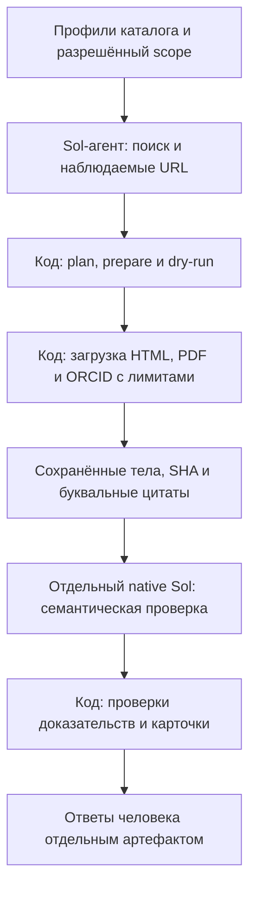

# Enrichment: явный поиск → источники → Sol → человек

**Основной вход в модуль, состояние на 14.10.2026 после merge
[PR #210](https://github.com/borisboriov/search-for-research/pull/210).** Здесь —
поддерживаемый процесс, установка, входы и правила запуска. Датированные
эксперименты, их метрики и частные архивы — в [карте исследований](research/INDEX.md).
Исторические методики и `scripts/enrichment_*` не являются инструкцией нового запуска.

## Зачем нужен модуль и где его границы

`enrichment` — отдельный технический и исследовательский модуль внутри
репозитория SFR, со своим CLI, кодом, тестами и материалами экспериментов.
Это не отдельный бизнес и не готовая функция production-сайта. Он использует
ресурсы этого репозитория; самостоятельная установка вне него и перенос на
другой компьютер в live-режиме пока не доказаны.

Продуктовая проблема: после подбора исследователя студенту нужно найти способ
связаться с ним. Рабочая продуктовая гипотеза — контакты с понятным источником
и подтверждённой принадлежностью уменьшают ручной поиск и помогают перейти
от подбора к обращению. Рост обращений, ответов учёных и успешных пар
«студент — руководитель» этими техническими опытами ещё не проверен.
Общий контекст и требования принадлежат [брифу](../docs/product/brief.md)
и [спецификации, C5–C6](../docs/product/mvp_spec.md).

Задача модуля — получить проверяемые кандидаты контактов из публичных
профессиональных источников для заданных профилей каталога. Личность нельзя
связать одним совпадением имени; нужны идентификаторы и предметные якоря.
Email на странице не доказывает его доставляемость, нынешнюю актуальность
или готовность учёного брать студентов. Рассылки и изменение production
данных в рабочий цикл модуля не входят.

## Как устроен поддерживаемый путь



Поиск пока выполняет внешний агент; CLI не содержит собственного поисковика.
Код отвечает за очередь, ограничения, сохранение источников, привязку цитат,
учёт попыток и подготовку карточек. Отдельный проверяющий оценивает личность,
принадлежность контакта и смысл доказательств по полной рубрике. Человек
проверяет текст, принадлежность, датированность источника и свидетельства
нынешней актуальности раздельно; «недостаточно оснований» допустимо.
Выход — локальные артефакты и карточки, не автоматическая публикация контактов.
Исторические GLM/Pi варианты сохранены для исследования, но не являются
поддерживаемым маршрутом запуска. Причины решений — в
[DECISIONS](../docs/DECISIONS.md), доказательства — в [карте](research/INDEX.md).

## Текущее состояние и ограничения

Перенос модуля (#194), бесплатное сравнение компонентов (#198/#200), рабочая
интеграция (#202/#204), поиск по пропускам (#205/#206), незавершённый первый
прогон десятки (#207/#208) и его ограниченное продолжение (#209/#210) влиты.
Подробная последовательность и исходные измерения находятся в
[INDEX](research/INDEX.md); старые отрицательные результаты сохранены.

Последняя десятка имеет **10 явных исходов, из них 6 проверены моделью**:
два входа остались больше 1 MB, ещё два ответа не прошли проверку даты.
Sol принял 3 личных контакта у 3 людей. Это завершение очереди, не 10/10
проверенных профилей. [Отчёт #209](research/reports/compact209_20261014.md)
сохраняет измеренный результат и `human 0` на момент прогона.

**Последующая человеческая проверка хранится отдельно.** Борис проверил эти
3 контакта: текст и принадлежность согласованы у всех трёх; у двух согласованы
также дата источника и приведённые основания актуальности, у одного дата
неопределённа, с актуальностью человек не согласился. Это оценка предъявленных
доказательств, не проверка доставляемости или готовности принимать студентов.
Происхождение отдельной записи раскрыто в [карте](research/INDEX.md#текущее-состояние-и-последовательность-этапов).

Рабочий процесс применим к разрешённым партиям **1–10 профилей**, с отдельным
поиском и просмотром карточек человеком. Бесплатное сравнение #198 завершено;
платная часть с поиском Яндекса не разрешена. Новая партия, расходы и внедрение
требуют отдельного поручения. Обогащение не выложено, production-каталог не менялся.
Полное покрытие, регулярное обновление, переносимость live-режима, массовая
экономика и доля ручного труда не установлены. Поиск студентов и условия набора
не входят в поддерживаемый контактный процесс.

## Возможное исследование Бориса для НИР-3

Модуль предоставляет инженерный объект и доказательства для возможного
исследования достоверности профилей. Личный вопрос, гипотеза и методика ведутся
в [#154](https://github.com/borisboriov/search-for-research/issues/154), основания —
в [обзоре](../docs/product/research/profile_evidence_review_2026-10.md), требования —
в [документе НИР-3](../docs/product/course_grading_NIR3.md). Направление раздельной
проверки личности, смысла поля и времени ещё не является согласованным протоколом.
Инженерный вопрос затрат рассматривается в [сравнении #198](research/reports/free_components198_20261013.md)
и не заменяет эту гипотезу. Исторические результаты и разметка — материал разработки,
не независимый тест новой гипотезы. Второй план НИР и копии корпусов здесь не ведём.

## Структура модуля

| Часть | Назначение |
|---|---|
| `src/sfr_enrichment/` | Поддерживаемый runtime: loader, literal binding, native verifier, guards, human cards |
| `configs/verifier-v3.md` | Прежняя рубрика, байты не изменены |
| `tests/` | Перенесённые регрессии и проверки границ модуля с заблокированными реальными транспортами |
| `research/methods/`, `research/reports/` | Версионированные методики и результаты прежних этапов |
| `research/legacy/` | Исторические GLM/night/Pi эксперименты; runtime их не импортирует |

## Установка и проверка без сети

Нужен checkout этого репозитория на конкретном Git SHA, Python 3.12+ и `uv`.
Из корня: `uv sync --locked --all-packages --group enrichment`, затем `make unhide`
(для editable imports на macOS). Версии библиотек заданы `uv.lock`, включая
`pypdf==6.19.0`. Изолированного wheel без ресурсов репозитория недостаточно.
Offline повтор установки возможен только при уже заполненном кэше зависимостей.
Команда `uv run sfr-enrichment --help` показывает единый CLI; равнозначен
`.venv/bin/python -m sfr_enrichment`.

После установки один воспроизводимый offline запуск регрессий из корня:

```sh
.venv/bin/python enrichment/tests/run_offline.py
```

Он блокирует реальную сеть и запуски клиентов моделей; локальные Python-процессы
для help и PDF разрешены. Для проверки собственного сохранённого sealed архива:

```sh
.venv/bin/python -m sfr_enrichment archive-check \
  --root "$SFR_ENRICHMENT_ARCHIVE" --index "$SFR_ENRICHMENT_INDEX" \
  --index-sha "$SFR_ENRICHMENT_INDEX_SHA"
```

Все три значения берутся из частного каталога архивов. Для final assisted live3
проверено 219 mapped файлов; полный SHA transfer index начинается `183162a57035`.
Точный индекс, SHA и путь сохранены в архиве, без переименования. Команда читает
данные и не вызывает источники или модели. `saved` дополнительно проверяет
старый baseline и создаёт новый локальный human packet, поэтому требует нового
выходного root. Точные исторические входы для него — в
[датированной методике](research/methods/enrichment_glm_runner.md#пересоздать-baseline-карточки-без-вызовов-контактный-протокол-v4).

## Входы нового разрешённого запуска

Подготовить три локальных JSON. Пути, источники, разрешение и лимиты задаются
для конкретного запуска; пример команд ниже сам по себе не разрешает сбор.

| Вход | Контракт |
|---|---|
| Локальный вход profiles.json | Список 1–10 каталожных профилей с уникальными `id`; передать имеющиеся имя, организацию, ORCID и предметные якоря для проверки личности |
| Локальный вход plan.json | `schema: sol-assisted-contacts-v1`, `requested_search_model: gpt-6.1-sol`, `requested_search_effort: high`, `profiles: [{author_id, sources: [...]}]`; те же ID, 1–8 уникальных наблюдённых URL на профиль |
| Элемент `sources` | `url`, `kind` из `direct_http` / `direct_pdf` / `structured_orcid`, `discovery: {method, observed_url, note, query}`. `method`: `agent_search`, `observed_href` либо `known_orcid`; `observed_url` совпадает с `url`, `note` непустой, `query` обязателен для `agent_search` |
| Локальный вход scope.json | `authorization_reference`, явный bool `live_authorized`, `deadline_acquisition` и `deadline_verification` с часовым поясом; `HTTP_total_cap` 1–200, `HTTP_per_profile_cap` 1–30, `remaining_stop` из 0/5/15 (0 — только по прямому разрешению) |
| Дополнительные ограничения scope | `model_job_cap` 1…число профилей (по умолчанию число профилей); опциональный `disk_byte_cap` 1…512 MiB. Для ORCID — `ORCID_policy` с `access: allowed`, `source: https://pub.orcid.org/v3.0` и сохранённым основанием доступа |

Диапазоны — возможности CLI, не автоматически разрешённый бюджет. Поисковый
агент сохраняет фактические запросы, наблюдённые URL и доступные tool receipts.
`discovery` является записью агента, не независимым подтверждением физического
запроса. Сниппеты и предполагаемые ответы не заменяют загруженный источник.
Неизвестные usage, фактическая модель/effort и стоимость остаются неизвестными.

Для проверенного буквального MathNet-декодера предусмотрен `render_mathnet: true`
только у `direct_http`; известный шаблон также обнаруживается автоматически.
Код читает наблюдённый script URL и распознаёт поддерживаемую функцию, не исполняет
произвольный JS. Эти запросы входят в HTTP-бюджет. Универсальные браузер/OCR и
автономный поиск в рабочий CLI не входят.

## Поддерживаемые команды и исходы

Для другого компьютера нужны тот же Git SHA/lock, локальные входы, новый частный
абсолютный data-root, действующий доступ native `codex` CLI по подписке и отдельно
доступный поисковый инструмент у Sol-агента. CLI поиска не предоставляет;
запись discovery не заменяет tool receipt. Исторические Pi SDK зависимости не
нужны рабочему пути. Пользователь отдельно задаёт выборку, разрешение, HTTP/model
лимиты, сроки и основание ORCID access. Поиск передаёт локальные profiles.json и
plan.json; scope.json фиксирует это разрешение.

После такого разрешения из корня checkout:

```sh
uv run sfr-enrichment prepare --root "$SFR_ENRICHMENT_DATA_ROOT" \
  --profiles /absolute/profiles.json --plan /absolute/plan.json --scope /absolute/scope.json
uv run sfr-enrichment dry-run --root "$SFR_ENRICHMENT_DATA_ROOT"
uv run sfr-enrichment status --root "$SFR_ENRICHMENT_DATA_ROOT"
# Только для отдельно разрешённого live scope и фактического официального остатка:
uv run sfr-enrichment run --live --root "$SFR_ENRICHMENT_DATA_ROOT" \
  --remaining-percent ACTUAL_OFFICIAL_PERCENT --author-id FIRST_FROZEN_PROFILE_ID
# Затем весь тот же frozen sample: готовый smoke output переиспользуется.
uv run sfr-enrichment run --live --root "$SFR_ENRICHMENT_DATA_ROOT" \
  --remaining-percent ACTUAL_OFFICIAL_PERCENT
```

`prepare` фиксирует sample/plan/scope/policy и SHA фактического рабочего кода,
lock, packaging и рубрики; источники и модели не вызывает. `dry-run` проверяет
freeze, `status` показывает состояние. `run` выполняет автоматические стадии
после внешнего поиска; один writer lock защищает root. Завершённые результаты
перепроверяются и используются без нового модельного вызова.

| Ситуация | Поведение текущего CLI |
|---|---|
| Ожидаемая недоступность источника, отказ robots/access или лимит одного профиля | Сохраняется причина в `source-failures`; разрешённые независимые источники/профили продолжаются. Domain STOP сохраняется для соответствующего домена |
| Нет пригодных источников / нет доказательств | Профиль получает `no_usable_source` / `empty_evidence`, модель не вызывается; это не отсутствие контакта у человека |
| Доставляемый input + instruction больше 1 000 000 bytes после lossless уплотнения | `input_too_large`, без модели и обрезки доказательств; следующие профили продолжаются |
| Неподдержанная metadata-дата личности либо год даты отсутствует в cited refs | После проверки целостности результат сохраняется как `invalid_identity_metadata_date` / `date_year_absent_unverified`; проверенная карточка не выдаётся, остальные профили продолжаются |
| Исчерпаны общие HTTP/model/disk/quota лимиты или deadline; root/parent STOP; неизвестный исход начатой попытки | Новые вызовы прекращаются; это не локальный отказ, который можно пропустить |
| Изменены freeze/SHA, неверна схема/ссылка доказательства или обнаружена иная ошибка целостности/даты | Ошибка останавливает запуск. Исключения из предыдущих строк не ослабляют общую проверку |

Карточки строятся только для результатов, прошедших проверки источников, схемы
и даты. Непроверенные исходы видны в progress; если проверенных результатов нет,
создаётся локальный unverified-progress.json, а не пустой успешный пакет. Завершение
очереди не означает успешной проверки всех профилей.

**Продолжение:** тот же незавершённый root допустим только в рамках прежнего
разрешения, с теми же freeze и лимитами, без STOP и неизвестных попыток. Готовые
и отклонённые профили/источники автоматически не повторяются. Нельзя удалять
STOP, менять caps или переписывать результаты для возобновления. После изменения
кода или отдельного разрешённого продолжения нужен новый согласованный root;
перенос результатов требует проверки SHA и раздельного учёта прежних затрат.
Универсальной команды миграции исторического запуска CLI не предоставляет.

Человек проверяет скачанную карточку и сохраняет фактические ответы отдельно:

```sh
uv run sfr-enrichment human import --root /absolute/new-human-answers-root \
  --manifest /absolute/packet/manifest.json --answers /absolute/human-answers.json \
  --record-id ACTUAL_RECORD_ID
```

Для контактного протокола v4 это четыре независимые оси: `text`, `identity`,
`source_date`, `current`. Неопределённость допустима; ответ о приведённых
доказательствах не подтверждает доставляемость или набор студентов. Частные
ответы не включаются в Git и не меняют frozen метрики исходного прогона.

## Совместимость и хранение

Прежние Python entrypoints в `scripts/enrichment_*.py` и JS-адаптеры сохранены
для исторической совместимости и replay. Они не рекомендуются для новой работы;
единственный поддерживаемый вход — `sfr-enrichment`. `research/legacy/` и
датированные методики объясняют старые протоколы. Для проверки исторического
freeze нужны его точные Git SHA и lock; новый код не подставляется вместо них.

Новый рабочий путь сохраняет один `events.jsonl` native verifier, полный raw/result,
receipt, request, usage, ошибки и timeout. Pi-клиент с отдельным полным snapshot
на каждый token delta не импортируется. Это устранение источника будущего
раздувания без сжатия. В рабочем assisted verifier #202 stdout/events и stderr
ограничены **16 MiB каждый**: переполнение завершает job без повтора и сохраняет
частичный лог/отказ. Источники и производные сохраняются полностью в действующих
лимитах (8 MiB PDF, 2 MiB другие ответы). Опциональный `scope.disk_byte_cap`
проверяется перед HTTP и native job с консервативным резервом; в #202 задано
128 MiB. Это отдельное ограничение от лимита каждого потока.

Частные данные, raw, human answers, STOP и seals не входят в git. Старые архивы
сейчас объединены ссылками в каталоге: ни перемещения, ни удаления, ни сжатия,
ни освобождённого места. Для будущих запусков предлагается один внешний
`SFR_ENRICHMENT_DATA_ROOT` с отдельным root на разрешённый run; прежние каталоги
остаются адресуемыми оригиналами.
