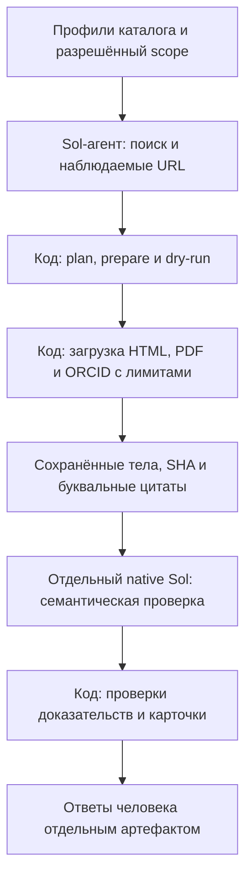

# Enrichment: явный поиск → источники → Sol → человек

Рабочий модуль контактов Search For Research. Алгоритмы, рубрика и принятые
границы результата сохранены; [карта исследований и хранения](research/INDEX.md)
ведёт к baseline, human record и live3. Перенос [PR #194](https://github.com/borisboriov/search-for-research/pull/194)
и бесплатное сравнение [PR #200](https://github.com/borisboriov/search-for-research/pull/200)
влиты 13.10.2026. Интеграция и новая пятёрка также влиты в
[PR #204](https://github.com/borisboriov/search-for-research/pull/204):
[результаты и ограничения #202](research/reports/runtime202_20261013.md).

## Зачем нужен модуль и где его границы

`enrichment` — отдельный технический и исследовательский модуль внутри
репозитория SFR, со своим CLI, кодом, тестами и материалами экспериментов.
Это не отдельный бизнес и не готовая функция production-сайта. Он использует
ресурсы этого репозитория; самостоятельная установка вне него и перенос на
другой компьютер в live-режиме пока не доказаны.

Продуктовая проблема: после подбора исследователя студенту нужно найти способ
связаться с ним. Рабочая продуктовая гипотеза — контакты с понятным источником
и подтверждённой принадлежностью уменьшают ручной поиск и помогают перейти
от подбора к обращению. Рост обращений, ответов учёных и успешных пар
«студент — руководитель» этими техническими опытами ещё не проверен.
Общий контекст и требования принадлежат [брифу](../docs/product/brief.md)
и [спецификации, C5–C6](../docs/product/mvp_spec.md).

Задача модуля — получить проверяемые кандидаты контактов из публичных
профессиональных источников для заданных профилей каталога. Личность нельзя
связать одним совпадением имени; нужны идентификаторы и предметные якоря.
Email на странице не доказывает его доставляемость, нынешнюю актуальность
или готовность учёного брать студентов. Рассылки и изменение production
данных в рабочий цикл модуля не входят.

## Как устроен поддерживаемый путь



Поиск пока выполняет внешний агент; CLI не содержит собственного поисковика.
Код отвечает за очередь, ограничения, сохранение источников, привязку цитат,
учёт попыток и подготовку карточек. Отдельный проверяющий оценивает личность,
принадлежность контакта и смысл доказательств по полной рубрике. Человек
проверяет текст, принадлежность, датированность источника и свидетельства
нынешней актуальности раздельно; «недостаточно оснований» допустимо.
Выход — локальные артефакты и карточки, не автоматическая публикация контактов.
Исторические GLM/Pi варианты сохранены для исследования, но не являются
поддерживаемым маршрутом запуска. Причины решений — в
[DECISIONS](../docs/DECISIONS.md), доказательства — в [карте](research/INDEX.md).

## Что проверено и что предстоит

Срез доказательств на 11.10.2026; документационная вводная уточнена 13.10.2026.

| Проверка | Получено | Чего это не доказывает |
|---|---|---|
| Baseline10, Sol-assisted | 8 личных контактов: 3 исторических, 5 без даты; человек подтвердил текст и принадлежность восьми | Нынешняя актуальность неизвестна; не приёмка целых профилей и не репрезентативная оценка каталога |
| Сквозной live3 на знакомых профилях | 3 запуска завершены; 2 прежних контакта найдены снова, лабораторный адрес не принят как личный | Не слепой тест на новых людях; конфликт аффилиации Maslov сохранён |
| Выделение модуля | Независимое ревью и CI, 260 офлайн-тестов; SHA 2468 файлов четырёх архивов совпали | Не новый live-прогон и не проверка переносимости на другом компьютере |
| Хранение | Каталогизированы 44 архивных root; источник раздувания Pi исключён из рабочего пути | Архивы не перемещены/удалены/сжаты, место не освобождено; общего hard cap native-журнала нет |

Первоисточники чисел и точные версии находятся в [research/INDEX.md](research/INDEX.md)
и связанных отчётах. Прежние отрицательные результаты GLM сохраняются с их
условиями; они не доказывают непригодность модели для всех задач.

Следующий согласованный эксперимент — [#198](https://github.com/borisboriov/search-for-research/issues/198):
сравнить готовые бесплатные компоненты на той же десятке и одинаковых
материалах. Платный поиск Яндекса выделен в отдельный шаг с подключением
и разрешением расходов. Ещё предстоят независимая новая выборка, измерение
полных затрат и доли ручной работы, проверка переносимости и отдельное решение
о внедрении. Автономный массовый сбор и экономика 1 000/10 000 профилей не доказаны.

## Возможное исследование Бориса для НИР-3

Модуль может стать объектом личного инженерного исследования Бориса, связанного
с продуктовой задачей доступного и проверяемого контакта. Это **кандидат
направления**, а не утверждённая личная гипотеза или завершённая НИР.
Основание требований — [критерии НИР-3](../docs/product/course_grading_NIR3.md).
Актуальная проработка личного вопроса и решения ведутся в
[#154](https://github.com/borisboriov/search-for-research/issues/154) и
[обзоре достоверности профилей](../docs/product/research/profile_evidence_review_2026-10.md).
Там предложено сравнение общей и раздельной проверки личности, поля и времени.
Ниже описан дополнительный инженерный вопрос экономии; он не заменяет
эту проработку и не назначает окончательную тему НИР.

Возможный исследовательский вопрос: позволяет ли сочетание готовых парсеров,
детерминированных правил и выборочной модельной проверки уменьшить затраты
на корректно связанный контакт без неприемлемой потери качества относительно
Sol-assisted способа? Проверяется архитектура получения данных; её результат
сам по себе не подтверждает спрос, продажи или рост обращений студентов.

До подтверждающего эксперимента нужно согласовать личную гипотезу и нулевую
гипотезу, обосновать по обзору источников численные пороги допустимой потери
качества и требуемой экономии, размер и способ отбора выборки. Пороги нельзя
подбирать после просмотра результатов. Известная десятка подходит для
отладки и парного сравнения компонентов; для обобщения нужна отдельно
зафиксированная новая выборка и независимая разметка. Разработка модуля —
инженерный результат; она не заменяет проверку исследовательской гипотезы.

| Материал исследования | Что уже есть / что подготовить |
|---|---|
| Проблема и связь с УЦП | Бриф и C5–C6; сформулировать личный вклад Бориса и согласовать тему |
| Теоретическое обоснование | История подходов в методиках/DECISIONS; нужен связный обзор научных и технических источников, а не только список инструментов |
| Протокол сравнения | #198 — пилотный план; отдельно зафиксировать гипотезы, критерии, выборку и правила оценки до подтверждающего прогона |
| Воспроизводимость | Git SHA, lock, scope/manifest, сохранённые источники и SHA, версии правил/моделей, журналы попыток и ошибок |
| Разметка | Реальные human-v3 ответы на 8 контактов; current uncertain сохраняется, новые оценки хранятся отдельно |
| Метрики и выводы | Отчёты baseline/live3; для нового сравнения нужны результаты по каждому профилю, ошибки, потери, время, диск, модельные расходы и ручной труд |

Считать отдельно точность принадлежности принятого контакта, восстановление
известных корректных контактов, долю профилей с контактом и долю случаев,
требующих модели/человека. Полнота по известным восьми не равна полноте по всем
существующим адресам. Стоимость на корректный контакт включает явно указанные
компоненты; токены проверки не равны полной стоимости поиска и разработки,
а тариф API не заменяет реальный расход подписки. На малых выборках показывать
абсолютные числа и неопределённость, сохранять отрицательные результаты.

Не создавать вторую хронику и копии корпусов ради НИР: использовать карту
`research/INDEX.md`, существующие методики и отчёты. Новые протоколы/результаты
добавлять в соответствующие разделы research с единственной ссылкой из карты.
Сырые источники и личные ответы остаются в частном data-root; в Git — код,
методика и допустимые агрегаты. Старые артефакты и оценки не переписываются.

## Структура модуля

| Часть | Назначение |
|---|---|
| `src/sfr_enrichment/` | Поддерживаемый runtime: loader, literal binding, native verifier, guards, human cards |
| `configs/verifier-v3.md` | Прежняя рубрика, байты не изменены |
| `tests/` | Перенесённые регрессии и проверки границ модуля с заблокированными реальными транспортами |
| `research/methods/`, `research/reports/` | Версионированные методики и результаты прежних этапов |
| `research/legacy/` | Исторические GLM/night/Pi эксперименты; runtime их не импортирует |

## Установка и проверка без сети

Нужен checkout этого репозитория на конкретном Git SHA, Python 3.12+ и `uv`.
Из корня: `uv sync --locked --all-packages --group enrichment`, затем `make unhide`
(для editable imports на macOS). Версии библиотек заданы `uv.lock`, включая
`pypdf==6.19.0`. Изолированного wheel без ресурсов репозитория недостаточно.
Offline повтор установки возможен только при уже заполненном кэше зависимостей.
Команда `uv run sfr-enrichment --help` показывает единый CLI; равнозначен
`.venv/bin/python -m sfr_enrichment`.

После установки один воспроизводимый offline запуск регрессий из корня:

```sh
.venv/bin/python enrichment/tests/run_offline.py
```

Он блокирует реальную сеть и запуски клиентов моделей; локальные Python-процессы
для help и PDF разрешены. Для проверки собственного сохранённого sealed архива:

```sh
.venv/bin/python -m sfr_enrichment archive-check \
  --root "$SFR_ENRICHMENT_ARCHIVE" --index "$SFR_ENRICHMENT_INDEX" \
  --index-sha "$SFR_ENRICHMENT_INDEX_SHA"
```

Все три значения берутся из частного каталога архивов. Для final assisted live3
проверено 219 mapped файлов; полный SHA transfer index начинается `183162a57035`.
Точный индекс, SHA и путь сохранены в архиве, без переименования. Команда читает
данные и не вызывает источники или модели. `saved` дополнительно проверяет
старый baseline и создаёт новый локальный human packet, поэтому требует нового
выходного root. Контракт inputs/scope и команды описаны в
[действующей части методики](research/methods/enrichment_glm_runner.md#sol-assisted-контакты-переносимый-offline-tested-workflow-11102026).

## Будущий live запуск

Для другого компьютера нужны тот же Git SHA/lock, локальные входы, новый частный
абсолютный data-root, действующий доступ native `codex` CLI по подписке и отдельно
доступный поисковый инструмент у Sol-агента. CLI поиска не предоставляет;
запись discovery не заменяет tool receipt. Исторические Pi SDK зависимости не
нужны рабочему пути. Пользователь отдельно задаёт выборку, разрешение, HTTP/model
лимиты, сроки и основание ORCID access. Поиск передаёт локальные profiles.json и
plan.json; scope.json фиксирует это разрешение.

После такого разрешения из корня checkout:

```sh
uv run sfr-enrichment prepare --root "$SFR_ENRICHMENT_DATA_ROOT" \
  --profiles /absolute/profiles.json --plan /absolute/plan.json --scope /absolute/scope.json
uv run sfr-enrichment dry-run --root "$SFR_ENRICHMENT_DATA_ROOT"
# Только для отдельно разрешённого live scope и фактического официального остатка:
uv run sfr-enrichment run --live --root "$SFR_ENRICHMENT_DATA_ROOT" \
  --remaining-percent ACTUAL_OFFICIAL_PERCENT --author-id FIRST_FROZEN_PROFILE_ID
# Затем весь тот же frozen sample: готовый smoke output переиспользуется.
uv run sfr-enrichment run --live --root "$SFR_ENRICHMENT_DATA_ROOT" \
  --remaining-percent ACTUAL_OFFICIAL_PERCENT
```

В #202 пять новых профилей прошли локальный live цикл: четыре кандидата, три
принятых Sol личных контакта без установленной актуальности, human_reviewed=0.
Код влит, обогащение не выложено; человеческой приёмки этих контактов нет. `prepare` замораживает все фактические `.py`
рабочего пакета, lock, packaging и рубрику; wrappers и исторические runners
не входят в новый freeze. Старые manifest/code hashes остаются неизменными:
для исторического code freeze нужен его точный Git SHA и lock, продолжать его
новым кодом нельзя. STOP/unknown attempt запрещают повтор. Ограничения sources,
robots, deadlines и полноты сохраняются; provenance не выдаёт requested модель
за фактически подтверждённую.

## Совместимость и хранение

Прежние Python entrypoints в `scripts/enrichment_*.py` — тонкие адаптеры к новым
модулям. Для извлечённых helpers compatibility adapter сохраняет старые
patch targets общих helpers и передаёт их подмены фактическим runtime globals;
различающиеся исторические функции остаются отдельными. Проверяются все
87 прежних строковых targets, включая native/source transports и восстановление. JS-адаптеры ведут в
`research/legacy/js/`. Исторические команды относятся к прежнему протоколу;
старый sealed live root возобновляют только его точной исторической версией.

Новый рабочий путь сохраняет один `events.jsonl` native verifier, полный raw/result,
receipt, request, usage, ошибки и timeout. Pi-клиент с отдельным полным snapshot
на каждый token delta не импортируется. Это устранение источника будущего
раздувания без сжатия. В рабочем assisted verifier #202 stdout/events и stderr
ограничены **16 MiB каждый**: переполнение завершает job без повтора и сохраняет
частичный лог/отказ. Источники и производные сохраняются полностью в действующих
лимитах (8 MiB PDF, 2 MiB другие ответы). Опциональный `scope.disk_byte_cap`
проверяется перед HTTP и native job с консервативным резервом; в #202 задано
128 MiB. Это отдельное ограничение от лимита каждого потока.

Частные данные, raw, human answers, STOP и seals не входят в git. Старые архивы
сейчас объединены ссылками в каталоге: ни перемещения, ни удаления, ни сжатия,
ни освобождённого места. Для будущих запусков предлагается один внешний
`SFR_ENRICHMENT_DATA_ROOT` с отдельным root на разрешённый run; прежние каталоги
остаются адресуемыми оригиналами.
